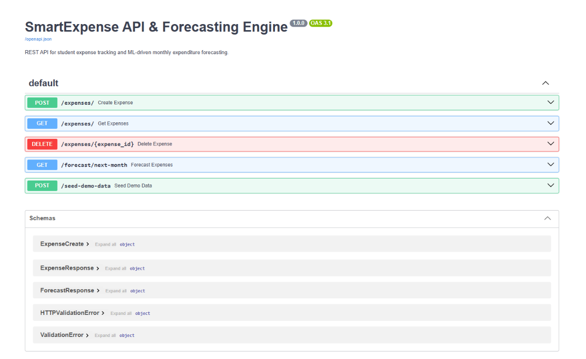

# SmartExpense API & Forecasting Engine

A RESTful backend service and machine learning forecasting engine designed for student and personal expense management. Built with **FastAPI**, **SQLAlchemy**, and **Scikit-learn**, this API handles CRUD operations with strict schema validation and predicts future monthly spending trends using time-series linear regression.

## Key Features
* **RESTful CRUD Operations:** Create, retrieve, filter (by category & date range), and delete expense records.
* **Pydantic v2 Schema Validation:** Enforces strict type checking, positive amount constraints, and structured JSON responses.
* **ML-Driven Expense Forecasting:** Uses `Scikit-learn` (`LinearRegression`) and `Pandas` to analyze historical monthly expenditure and predict next month's total budget alongside category-wise spending estimates.
* **One-Click Demo Seeding:** Includes a `/seed-demo-data` endpoint to populate 6 months of synthetic student expense records for instant testing.

## Tech Stack
* **Backend Framework:** Python, FastAPI, Uvicorn
* **Database & ORM:** SQLite, SQLAlchemy
* **Machine Learning & Data:** Scikit-learn, Pandas, NumPy
* **Validation:** Pydantic v2

---

## Quick Start (Installation & Setup)

1. **Clone the repository & navigate to the project folder:**
   `git clone [https://github.com/mdramjanalimondol002/smart-expense-api.git](https://github.com/mdramjanalimondol002/smart-expense-api.git)`
   `cd smart-expense-api`

2. **Install required dependencies:**
   `pip install -r requirements.txt`

3. **Start the FastAPI server:**
   `python -m uvicorn app.main:app --reload`

4. **Access the Interactive Swagger UI:**
   Open your browser and go to: **`[http://127.0.0.1:8000/docs](http://127.0.0.1:8000/docs)`**

---

## How to Use the API (Step-by-Step Guide)

Once you open **`[http://127.0.0.1:8000/docs](http://127.0.0.1:8000/docs)`** in your browser, you can test all features directly without writing any frontend code:

1. **Load Sample Data (Instant Testing):**
   * Click on **`POST /seed-demo-data`** -> Click **"Try it out"** -> Click **"Execute"**.
   * This automatically inserts 48 realistic student expense records across 6 months into the SQLite database.

2. **Run ML Expense Forecasting:**
   * Click on **`GET /forecast/next-month`** -> Click **"Try it out"** -> Click **"Execute"**.
   * The `Scikit-learn` Linear Regression engine will analyze historical spending and return a JSON response predicting your **next month's total expense**, **spending trend** (`Increasing` / `Decreasing` / `Stable`), and **category-wise budget breakdown** (`Academic`, `Food`, `Transport`, `Utilities`).

3. **Add a New Expense:**
   * Click on **`POST /expenses/`** -> Click **"Try it out"**.
   * Edit the request body (title, category, amount, date) and click **"Execute"** to save a new record to the database.

4. **Filter & Search Expenses:**
   * Click on **`GET /expenses/`** -> Click **"Try it out"**.
   * Filter records by `category` (e.g., `Academic` or `Food`) or specify a `start_date` and `end_date`, then click **"Execute"**.

---

## API Endpoints Overview

| Method | Endpoint | Description |
| :--- | :--- | :--- |
| `POST` | `/expenses/` | Add a new expense record with Pydantic validation |
| `GET` | `/expenses/` | Retrieve all expenses (supports category & date filtering) |
| `DELETE` | `/expenses/{expense_id}` | Delete a specific expense record by ID |
| `GET` | `/forecast/next-month` | Predict next month's total & category-wise expenses using ML |
| `POST` | `/seed-demo-data` | Populate database with 6 months of demo data for testing |
